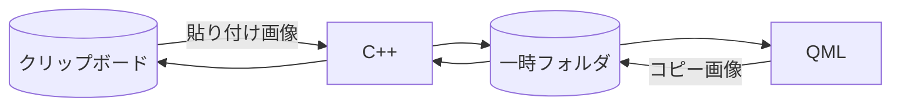

# クリップボード画像と一時ファイル

## 一時ファイルを使う理由

QML と C++ では、画像の受け渡し方が異なります。この実装では、その間を一時 PNG ファイルでつないでいます。

- **貼り付け**：クリップボードの画像を C++ が一時 PNG に保存し、そのファイル URL を QML に渡します。QML は URL を `Image.source` に設定して画像を表示します。
- **コピー**：QML がキャプチャ画像を一時 PNG に保存します。C++ は一時ファイルのパスを `QImage` のコンストラクターに渡して画像を読み込み、クリップボードに設定します。ファイルパスを渡すことで、`QImage` がその画像ファイルを読み込めます。

このように、一時フォルダに画像ファイルを作ると、QML には画像 URL を、C++ には `QImage` が読み込めるファイルパスを渡せます。

- **貼り付け**：C++ がクリップボード画像を一時保存し、ファイル URL を QML に渡して表示します。
- **コピー**：QML がキャプチャ画像を一時保存し、C++ がファイルから `QImage` を読み込んでクリップボードに設定します。

※ コピーされるのは図形データではなく、注釈を含む画像です。
