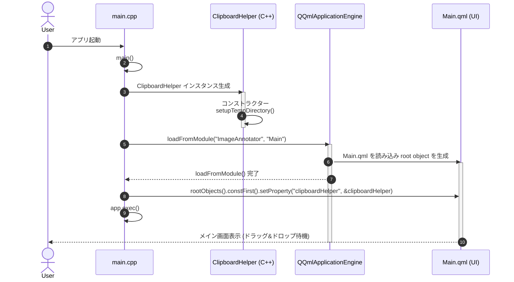
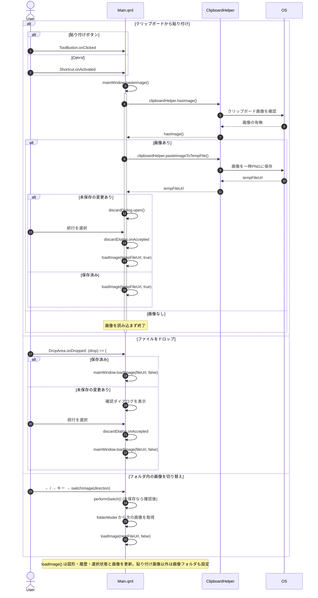
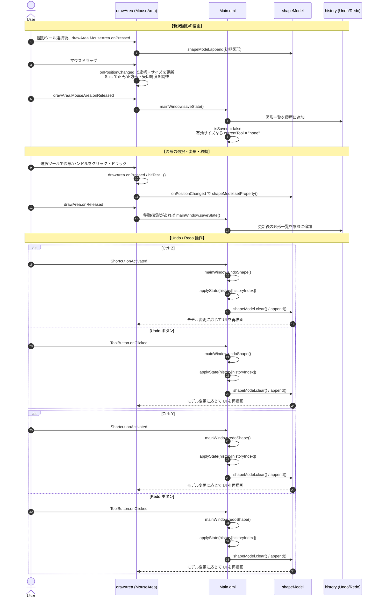
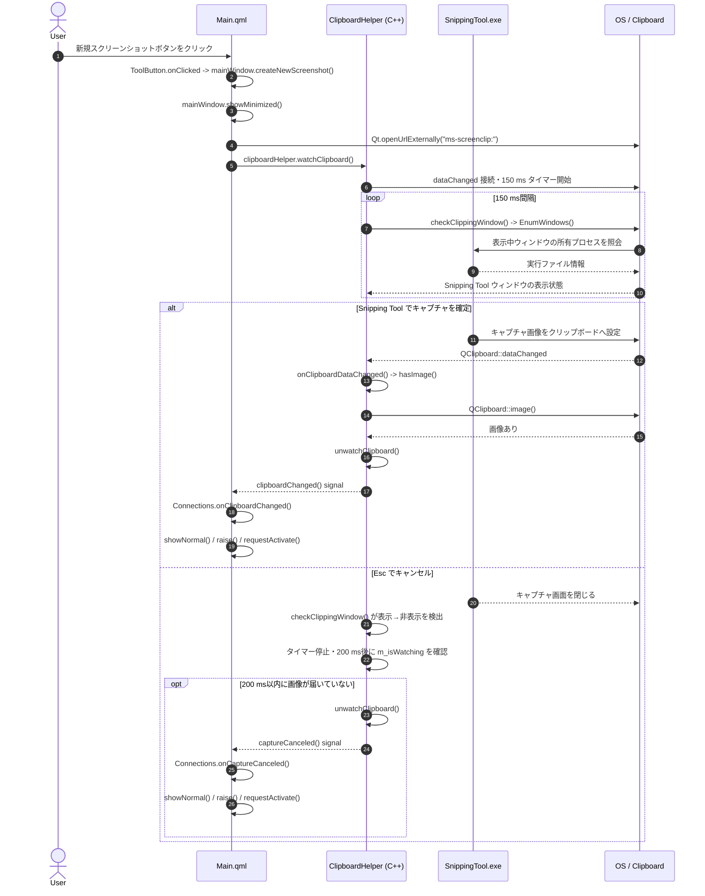
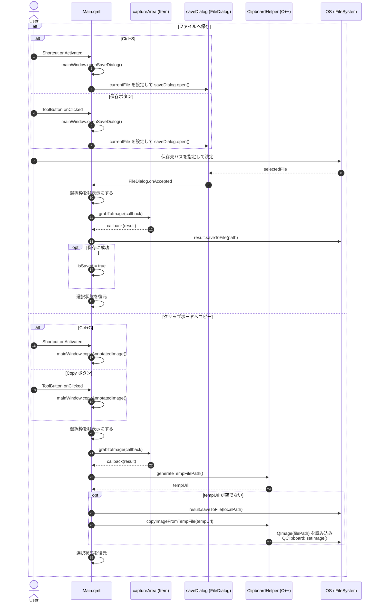

# 🎨 ImageAnnotator シーケンス図

Qt6 / QML で実装された `ImageAnnotator` の動作フロー図です。イベントの入口と、そこから呼び出される関数を明記しています。

## 1. コンポーネント構成概要

| コンポーネント | 役割・対象ファイル |
| --- | --- |
| **User** | アプリケーションの操作者 |
| **Main.qml (UI)** | ツールバー、キャンバス、マウス・キーボードイベント処理 |
| **Model / History** | 図形リスト (`shapeModel`)、Undo/Redo履歴 (`history`)、画像フォルダ (`folderModel`) |
| **ClipboardHelper** | QMLとOSクリップボード・一時ファイルI/Oを仲介するC++クラス (`clipboardhelper.cpp`) |
| **OS / FileSystem** | OSクリップボード、ローカルディスク |

## 2. アプリケーション起動・初期化フロー

## 3. 画像の読み込み・取り込みフロー

## 4. アノテーション描画・編集・Undo/Redoフロー

## 5. 新規スクリーンショットとキャンセル検知

## 6. アノテーション付き画像の出力（保存 / クリップボードコピー）

